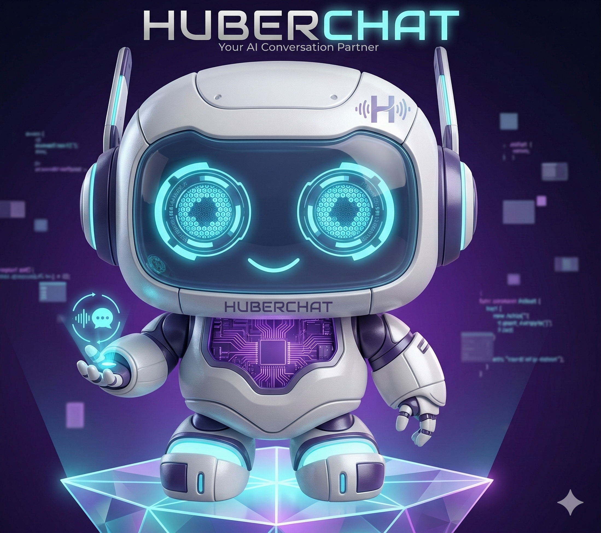

<div align="center">

# HuberChat

### Atendimento inteligente no WhatsApp para empresas que querem crescer.

Centralize conversas, automatize respostas, organize sua equipe e transforme cada contato em uma experiência profissional.

<br />

[](https://app.huberchat.com)
[](https://app.huberchat.com/docs)
[](LICENSE)

<br /><br />



</div>

---

## O atendimento da sua empresa em um só lugar

O HuberChat é uma plataforma SaaS multiempresa para operações de atendimento, vendas e automação pelo WhatsApp. Equipes pequenas ganham velocidade; operações maiores ganham controle, visibilidade e escala.

| Para sua equipe | Para seu cliente |
|---|---|
| Uma fila organizada por atendente, departamento e canal | Respostas mais rápidas e consistentes |
| Automação visual para os principais momentos da jornada | Atendimento humano quando realmente precisa |
| Indicadores, histórico e auditoria em um único painel | Conversas sem perda de contexto |

## Tudo o que uma operação moderna precisa

- **Inbox omnicanal:** conversas, grupos, mídia, histórico e filas em uma experiência única.
- **Automação visual:** fluxos com menus, mensagens, transferências, horários e encerramentos.
- **Inteligência artificial:** agentes configuráveis por empresa com provedores de IA integrados.
- **Gestão de equipes:** departamentos, permissões, distribuição e visibilidade por canal.
- **Financeiro conectado:** cobranças via Pix e boleto, integrações SGP e conciliação.
- **API para integrar:** envio de mensagens, mídia, grupos e webhooks para conectar seu ecossistema.
- **Experiência em qualquer lugar:** painel web responsivo e aplicativo mobile para Android e iOS.

## Como funciona

```text
Cliente chama no WhatsApp
          ↓
HuberChat identifica o contexto
          ↓
Automação ou IA resolve o primeiro momento
          ↓
Equipe assume quando necessário
          ↓
Gestão acompanha resultados e melhora a operação
```

## Arquitetura

```text
┌─────────────────────────────────────────────────────────────┐
│                    HuberChat Platform                       │
├──────────────────┬──────────────────┬───────────────────────┤
│ Painel Web       │ App Mobile       │ API & Integrações      │
│ React + Vite     │ Expo             │ tRPC + REST + Webhooks │
├──────────────────┴──────────────────┴───────────────────────┤
│ Backend Node.js · PostgreSQL · Baileys · IA · Billing        │
└─────────────────────────────────────────────────────────────┘
```

### Stack principal

| Camada | Tecnologia |
|---|---|
| Backend | Node.js, Express, TypeScript e tRPC |
| Banco de dados | PostgreSQL e Drizzle ORM |
| Painel web | React 19, Vite, Tailwind CSS e Radix UI |
| WhatsApp | Baileys nativo |
| Mobile | Expo e React Native |
| Integrações | EFI Pay, SGP, Popflix e webhooks |
| Operação | Docker e Nginx |

## Para quem é

O HuberChat foi pensado para provedores de internet, empresas de serviços, equipes comerciais, suporte técnico e operações que precisam atender muitos clientes sem perder proximidade.

## Comece agora

Quer conhecer a plataforma? Acesse **[app.huberchat.com](https://app.huberchat.com)** ou consulte a **[documentação da API](https://app.huberchat.com/docs)**.

Para executar uma cópia local do projeto:

```bash
git clone https://github.com/LinkjohnDEV/huberchat.git
cd huberchat
cp .env.example .env
npm install
npm run check
npm run dev
```

> Para produção, configure PostgreSQL, armazenamento e os serviços de WhatsApp antes de iniciar a aplicação.

## Projeto

Este repositório apresenta a plataforma HuberChat e sua evolução técnica. Para informações comerciais, demonstrações e implantação, fale com nossa equipe pelo site.

<div align="center">

### Atendimento mais humano. Operação mais inteligente. Crescimento mais previsível.

[Conheça o HuberChat →](https://app.huberchat.com)

<br />

<sub>HuberChat · automação e atendimento inteligente para empresas</sub>

</div>
